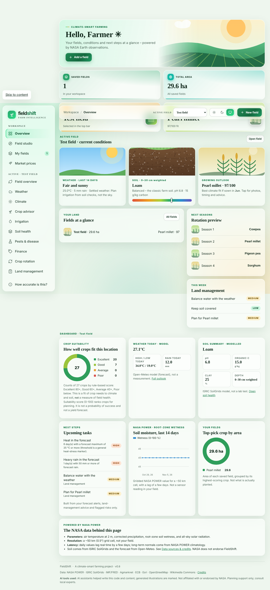
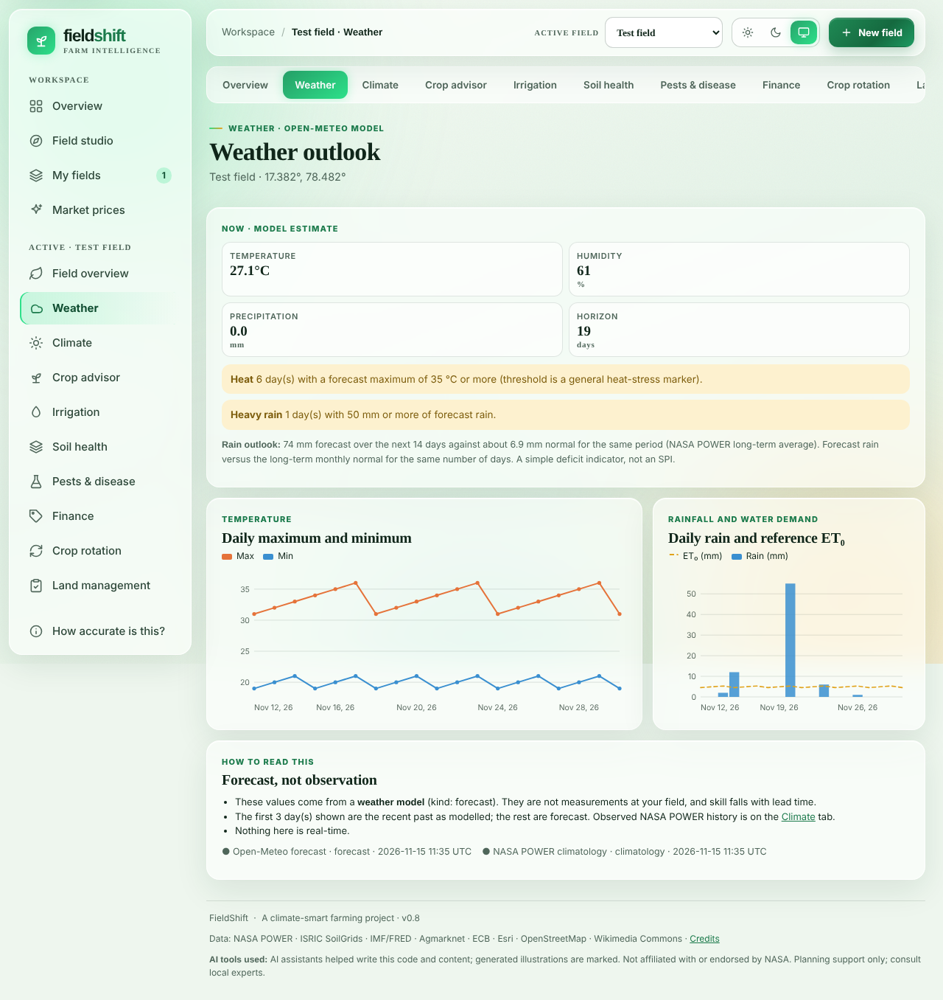
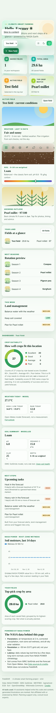
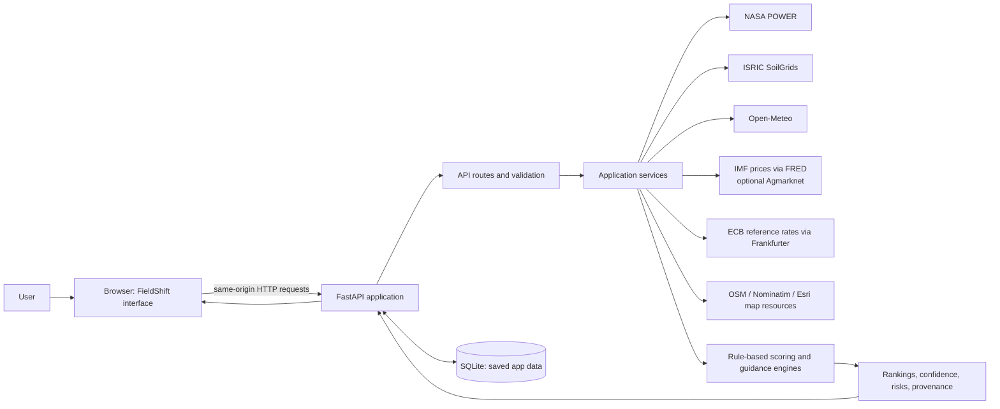
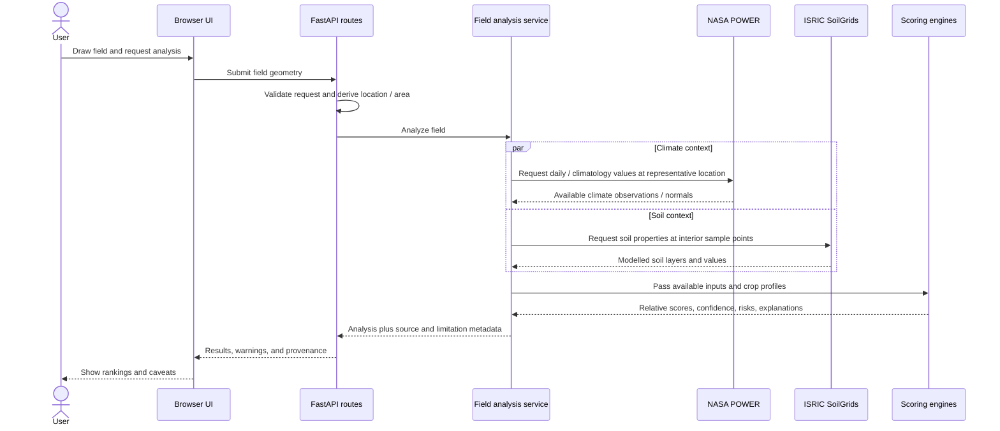

# FieldShift

**Climate-aware crop-planning decision support, informed by NASA data.**

| | |
|---|---|
| Version | 0.9.0 |
| Challenge | [Field Shift: Adapting Farms with NASA Data](https://www.spaceappschallenge.org/) |
| Team | Project Earthwise |
| Local event | Harohalli, India |
| Live demo | [Open FieldShift](https://fieldshift-84ys.onrender.com/#field) |

FieldShift helps a user explore a farm field, review climate and soil context, compare crop suitability, and inspect risks and data provenance. It is a planning aid, **not** an agronomic guarantee, a yield forecast, or financial advice. Suitability scores are rule-based indicators, not probabilities. No machine-learning crop recommendation model ships with this project.

## Screenshots

> **Preview note:** These repository screenshots are interface previews and may show fixture or demonstration data. They are not proof that live provider data is currently available. The screenshots were captured before the 0.9.0 release and may show an older footer version. Replace them with fresh screenshots from the deployed 0.9.0 app when available.



*Dashboard and field overview preview. Replace with an up-to-date screenshot from the live app.*



*Climate view preview. Provider availability and dates vary; check the source and as-of labels in the app.*



*Mobile layout preview.*

## At a glance

- Draw or edit a field on a map and review its area and location.
- Retrieve climate context from NASA POWER and soil context from ISRIC SoilGrids.
- Compare 27 crop profiles using visible suitability indicators and confidence labels.
- Inspect crop-specific downsides, including climate, water, soil, pests and disease, and price volatility.
- Review climate history against long-term normals, including temperature, rainfall, and solar radiation.
- Explore market-price context, source dates, cadence, currency conversion, and illustrative gross-value calculations.
- Review rotation ideas and land-management, irrigation, pest, and finance guidance.
- See data-source credits and accuracy limitations in the app.

Data sources can be delayed, unavailable, incomplete, or spatially coarse. FieldShift shows source and date information where available. It does not silently turn missing prices into live or observed prices.

## How to use FieldShift

1. **Open the field studio.** Use the map to draw or edit a field boundary. Map drawing is an estimate of the field footprint, not a land survey.
2. **Review the field context.** The server derives the field's area and representative location. Climate requests use the field centroid; soil requests use a limited set of interior sample points where possible.
3. **Load available data.** The backend requests NASA POWER climate data and ISRIC SoilGrids data, and may use other configured providers for forecasts or market context. Provider outages can leave some inputs unavailable.
4. **Inspect crop rankings.** The advisor evaluates the available inputs against crop profiles and ranks candidate crops. A score is a relative suitability indicator under the app's rules; it is not a probability of success or predicted yield.
5. **Read confidence and caveats.** Confidence reflects the completeness and quality of the inputs available to the app. It is not a statistical confidence interval or a guarantee that a recommendation will work.
6. **Compare risks and alternatives.** Review crop-specific risks, water needs, soil effects, market context, and rotation or land-management suggestions before making any real-world decision.
7. **Check provenance.** Use the source labels, as-of dates, cadence labels, and the in-app data credits to understand where each value came from and how current it is.

## What happens behind the scenes

The web interface and API are served by the same FastAPI application. The browser sends field and feature requests to the backend; backend services obtain external data, normalize it, and pass available inputs to deterministic scoring and guidance engines. Saved fields, settings, and account-related data use SQLite when persistence is configured.



### Field-analysis flow



External providers may be slow, rate-limited, unavailable, or return partial data. The actual analysis can therefore differ from this idealized flow; inspect the result's warnings and source metadata.

## How the crop score should be read

FieldShift uses deterministic, rule-based scoring. The scoring engine gives climate a base weight of 35%; the remaining factors are weighted according to the configured priorities for resilience, water, soil, and profit. When an input is unavailable, the engine excludes that component and renormalizes the remaining weights. The displayed suitability range is bounded (currently 1–99).

- A higher score means a better match under the app's available inputs and rules. It does **not** mean that crop success is more likely by that percentage.
- Confidence communicates input completeness, not the probability that a crop will thrive.
- Some crop thresholds and market assumptions are heuristic. The app labels illustrative estimates where applicable.
- Local varieties, planting calendars, irrigation infrastructure, field-level microclimates, pests, labor, and farm economics may not be represented adequately.
- A missing input can change both the score and its interpretation. Review the explanation and source status, not just the ranking.

For the implementation detail and current validation record, see [ARCHITECTURE.md](ARCHITECTURE.md), [VERIFICATION.md](VERIFICATION.md), and [KNOWN_LIMITATIONS.md](KNOWN_LIMITATIONS.md).

## Data sources

| Source | FieldShift use | Important context |
|---|---|---|
| [NASA POWER](https://power.larc.nasa.gov/docs/services/api/temporal/) | Daily climate and climatology, including temperature, precipitation, and solar radiation | Gridded, location-based estimates; spatial scale is roughly 0.5° (about 50 km) for the products used. Data may have a reporting delay. Not a field sensor. |
| [ISRIC SoilGrids 2.0](https://docs.isric.org/globaldata/soilgrids/index.html) | Modelled soil properties at representative field points | Global predictions at about 250 m resolution and defined depth layers; uncertainty and local soil variation matter. |
| [Open-Meteo](https://open-meteo.com/en/docs) | Forecast context where requested by app features | Forecast horizon and availability depend on the provider and endpoint. Not a long-term climate normal. |
| [IMF commodity prices via FRED](https://fred.stlouisfed.org/docs/api/fred/) | Historical commodity-price context | Periodic series, not a live local farm-gate quote. Source dates and cadence should be checked in the app. |
| Agmarknet via [data.gov.in](https://www.data.gov.in/) | Optional India market data when configured | Requires an optional `DATA_GOV_IN_API_KEY`; coverage depends on the dataset and location. |
| ECB reference rates via [Frankfurter](https://www.frankfurter.app/) | Currency conversion context | Reference rates are not bank, cash, or transaction rates. |
| OpenStreetMap / Nominatim / Esri | Map display, geocoding, and map resources | Subject to each provider's terms, attribution requirements, availability, and usage policies. |

NASA POWER is the NASA data source used by FieldShift. NASA does not endorse this project. The app does not use NASA logos or imply NASA endorsement. The complete, maintained source and attribution list is [backend/app/data/sources.md](backend/app/data/sources.md) and [DATA_SOURCES.md](DATA_SOURCES.md).

## Technology and repository layout

**Application:** Python, FastAPI, SQLite, HTML/CSS/JavaScript, MapLibre GL JS, and Docker. Provider access and scoring are handled in backend modules; the frontend is served by the backend as a single web service.

```text
FieldShift/
├── backend/
│   ├── app/
│   │   ├── api/                 # HTTP endpoints and request schemas
│   │   ├── core/                # configuration, security, logging, errors
│   │   ├── data/                # crop profiles, knowledge base, source credits
│   │   ├── engine/              # deterministic scoring and guidance logic
│   │   └── services/            # provider orchestration and application services
│   └── main.py                  # application entry point / compatibility shim
├── frontend/                    # browser application and static assets
├── docs/screenshots/            # UI previews used above
├── scripts/                     # smoke checks and project utilities
├── tests/                       # unit, integration, parity, and security checks
├── Dockerfile                   # single-service container deployment
├── render.yaml                  # Render Blueprint configuration
├── requirements.txt             # runtime dependencies
├── requirements-dev.txt         # development and test dependencies
├── run_tests.sh                 # test runner
├── API.md                       # API reference
├── ARCHITECTURE.md              # implementation architecture
├── DATA_SOURCES.md              # data sources and attribution
├── DEPLOY.md                    # deployment instructions
├── SECURITY.md                  # security notes
├── VERIFICATION.md              # checks actually run and their outcomes
└── KNOWN_LIMITATIONS.md         # known product and data limits
```

The diagram and tree are an orientation guide; consult the files in the repository for the current exact endpoints and implementation.

## Run locally

Run these commands from the repository root on Windows PowerShell:

```powershell
py -m venv .venv
.\.venv\Scripts\Activate.ps1
python -m pip install -r requirements.txt
uvicorn app.main:app --app-dir backend --reload
```

Then open [http://localhost:8000](http://localhost:8000). The server also exposes readiness and health routes; see [API.md](API.md) for the current route list. If PowerShell blocks virtual-environment activation, use the Python executable directly at `.venv\Scripts\python.exe` and `.venv\Scripts\uvicorn.exe`.

The app can also be started with the repository's compatibility entry point:

```powershell
uvicorn backend.main:app --reload
```

### Optional provider configuration

Most public data paths do not require a personal API key. The India Agmarknet integration is optional and uses `DATA_GOV_IN_API_KEY` when enabled. For production, configure a unique `FIELDSHIFT_SECRET_KEY` of at least 32 characters in the hosting provider's environment settings. Do not commit real keys or production secrets.

An `.env.example` file is a reference for variable names; do not assume a local `.env` file is loaded automatically. Set environment variables in your shell or hosting dashboard according to [DEPLOY.md](DEPLOY.md) and [SECURITY.md](SECURITY.md).

## Checks and verification

To run the project's checks locally:

```powershell
python scripts/smoke.py
```

The smoke check can also target a deployed URL, for example `python scripts/smoke.py https://your-service.example`. A warning can mean an upstream provider was unavailable; review the detailed output rather than treating every warning as an application failure.

For the test suite, install the development dependencies and use the repository's test runner. On Windows, use the project's supported shell or invoke the test commands documented in [VERIFICATION.md](VERIFICATION.md):

```powershell
python -m pip install -r requirements-dev.txt
```

**Release status:** do not describe checks as passing unless the current [VERIFICATION.md](VERIFICATION.md), local run, and GitHub Actions results confirm it. Live provider integrations and the public deployment also require a successful run against the deployed service. See the repository's [Tests workflow](.github/workflows/tests.yml) and GitHub Actions page for current results.

## Deploy on Render

The repository includes a [Render Blueprint](render.yaml) and a [Dockerfile](Dockerfile) for deploying the backend and frontend as one web service.

1. Push the intended release branch to the public GitHub repository.
2. In Render, create a Blueprint from the `Yashwanthmk72/FieldShift` repository and select the branch containing `render.yaml`.
3. Review the service name, region, plan, health-check path, generated secret, and environment variables before deploying. Add `DATA_GOV_IN_API_KEY` only if you have a key and want the optional integration.
4. After Render creates the service, wait for the deployment to finish and open its assigned public URL.
5. If the URL differs from the allowed origin in `render.yaml`, update `FIELDSHIFT_CORS_ORIGINS` to the exact public origin and redeploy.
6. Check `/readyz`, open the app, and run `python scripts/smoke.py https://YOUR-RENDER-URL`.
7. Add the confirmed public URL to the Demo row at the top of this README and replace the preview screenshots with genuine screenshots from the deployed release.

Render documents [Blueprints](https://render.com/docs/infrastructure-as-code) and [deploys from Git](https://render.com/docs/deploys). Its [free web services](https://render.com/docs/free) can sleep after inactivity and wake on a new request; local filesystem changes are ephemeral across restarts, redeploys, and spin-down. The configured SQLite database therefore should not be treated as durable production storage on an ephemeral free instance. Choose persistent storage or a managed database before relying on saved user data.

Follow [DEPLOY.md](DEPLOY.md) for the repository's full deployment settings and production security requirements.

## Limitations and responsible use

- **Decision support only.** Ask a local agricultural extension service or qualified agronomist before acting on crop, irrigation, pest, or soil recommendations.
- **Not a forecast of yield or profit.** The score is a relative rule-based suitability indicator. “Estimated gross value” describes revenue context and does not subtract costs or represent profit.
- **Spatial resolution.** NASA climate products and SoilGrids are gridded/modelled datasets. A field polygon does not make the underlying data field-measured. Results can miss within-field variation.
- **Heuristics.** Some crop-profile thresholds and risk assumptions are illustrative and may not represent local varieties or practices.
- **Incomplete or stale data.** Providers may be unavailable, delayed, rate-limited, or missing coverage. Market values are not real-time; a missing source should remain no data.
- **Local context.** The app cannot fully account for local regulations, seed availability, labor, water rights, soil tests, pest pressure, farm-gate prices, or household risk tolerance.
- **Deployment persistence.** A free ephemeral deployment is suitable for a demo, not durable storage of important user data.

Read [KNOWN_LIMITATIONS.md](KNOWN_LIMITATIONS.md), [SECURITY.md](SECURITY.md), and [VERIFICATION.md](VERIFICATION.md) before using or presenting the app.

## AI use, credits, and team

AI assistants helped with code, tests, copy, and documentation. Source-file headers indicate AI assistance where applicable. In-app illustrations are code-drawn and marked as AI-assisted illustrations. Any AI-generated images or videos added later should be visibly identified. No images of people under 18 are included.

The project uses NASA POWER and other sources listed above and in [DATA_SOURCES.md](DATA_SOURCES.md). NASA does not endorse FieldShift. Provider names and marks remain the property of their respective owners; follow each source's attribution and usage terms.

**Project Earthwise** — NASA Space Apps Challenge 2026, Harohalli, India

- Yashwanth M K — Team Owner
- Suhas V
- Sindu Gowda
- Sidhant Saswat
- Sohan Malode
- Trisha Shashanna

## Project documents

- [Submission overview](SUBMISSION.md)
- [Demo walkthrough](DEMO.md)
- [API reference](API.md)
- [Architecture](ARCHITECTURE.md)
- [Data sources and credits](DATA_SOURCES.md)
- [Deployment](DEPLOY.md)
- [Security](SECURITY.md)
- [Verification record](VERIFICATION.md)
- [Known limitations](KNOWN_LIMITATIONS.md)
- [Progress and release notes](PROGRESS.md) · [Changelog](CHANGELOG.md)

## Sources for data and hosting behavior

- GitHub's [README guidance](https://docs.github.com/en/repositories/managing-your-repositorys-settings-and-features/customizing-your-repository/about-readmes) and [Mermaid diagram support](https://docs.github.com/en/get-started/writing-on-github/working-with-advanced-formatting/creating-diagrams).
- NASA POWER [Temporal API](https://power.larc.nasa.gov/docs/services/api/temporal/).
- ISRIC [SoilGrids documentation](https://docs.isric.org/globaldata/soilgrids/index.html) and [FAQ](https://docs.isric.org/globaldata/soilgrids/SoilGrids_faqs_01.html).
- Open-Meteo [API documentation](https://open-meteo.com/en/docs) and FRED [API documentation](https://fred.stlouisfed.org/docs/api/fred/).
- Render [Blueprints](https://render.com/docs/infrastructure-as-code), [deploys](https://render.com/docs/deploys), and [free instance behavior](https://render.com/docs/free).
